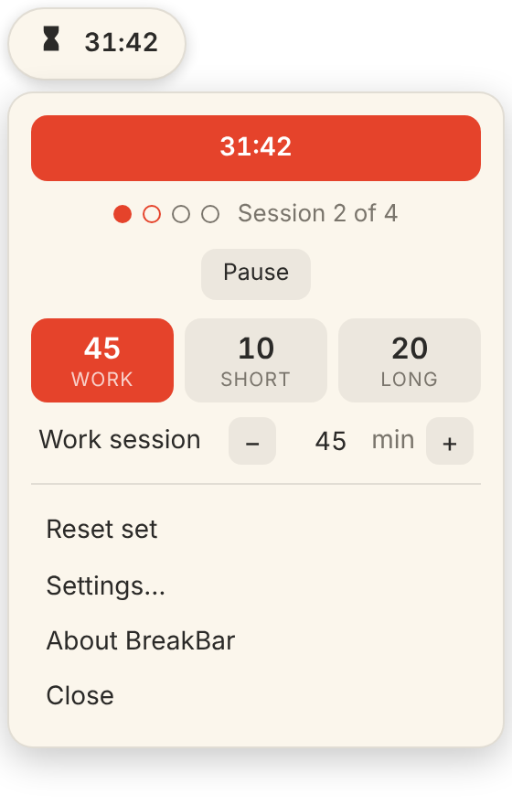
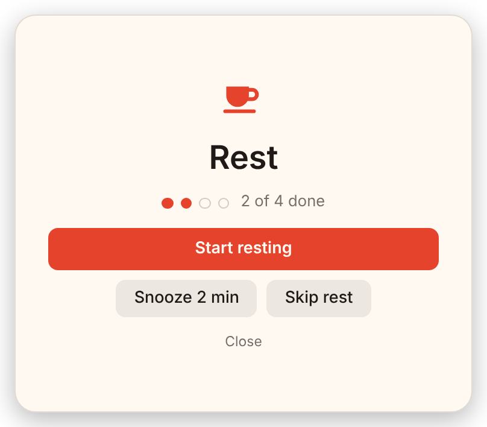
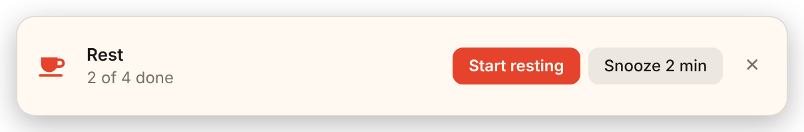
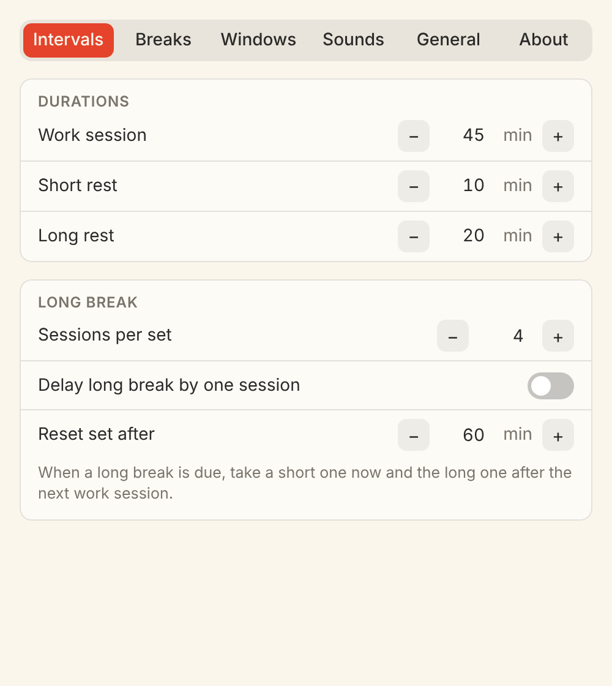

# BreakBar for Windows

**v0.1.0 pre-release.** A small floating Pomodoro timer for Windows. When a work session ends, a Rest window asks you to take a break. It is the Windows sibling of the [BreakBar menu bar app for Mac](https://github.com/12amcoffee/BreakBar), with the same timer, settings and wording.

<p align="center">
  
  
</p>

## Download

Go to the [Releases page](https://github.com/12amcoffee/BreakBar-for-Windows/releases) and download one of:

| File | What it is |
| --- | --- |
| `BreakBar-Setup.exe` | Installer. Installs for your user only, no administrator password. |
| `BreakBar-windows-x64.zip` | Portable. Unzip anywhere and run `BreakBar.exe`. |

**The first launch shows a warning.** BreakBar is not code-signed (a certificate costs money a hobby project does not have), so Windows SmartScreen says "Windows protected your PC". Click **More info**, then **Run anyway**. You only do this once. The source is all here, and every download is built on GitHub's own machines from this code.

Requires Windows 10 or 11, 64-bit, and Microsoft WebView2, which Windows 11 and up-to-date Windows 10 already have. The installer fetches it if it is missing.

## How it works

BreakBar is a pill that floats above your other windows, at the top left of your screen. It is not on the taskbar.

- **Click it** to open the dropdown. **Drag it** to move it. Click anywhere else, or press Esc, and it folds away.
- It fades when your mouse is away, and stays solid while it waits for you.
- Its icon shows what it is doing: an hourglass while you work, a bell when a rest is waiting, zzz when snoozed, a cup or a bed while you rest, and just the BreakBar mark when idle.
- If you lose it, open BreakBar from the Start menu again, or click its icon in the tray (it may sit under the `^` arrow). The tray menu has Show BreakBar, Settings and Close.

A session is **work, then rest**. After a set of sessions (4 by default) the rest is a long one.

| Work | Short rest | Long rest | Sessions per set |
| --- | --- | --- | --- |
| 45 min | 10 min | 20 min | 4 |

All of these are changeable. Click the Work, Short or Long box in the dropdown and type a number or use the plus and minus.

### The Rest window

When work ends, BreakBar shows a window asking you to **Start resting**, or to **Snooze** or **Skip**. After you start, it becomes a countdown. When the rest ends, a **Start working** window appears. Choose one of four styles in Settings, with a Preview button for each:

| Small floating window | Maximised window | Full-screen overlay | Notification-style banner |
| --- | --- | --- | --- |
| Click only, so a stray key press never answers it. Drag it where you like. | Return answers it, Esc hides it. | Covers every display. Esc hides it. | Slides in at the top right. |

Hiding a window never changes the timer; the pill still shows what it is waiting for.

<p align="center">
  
  
</p>

### Settings

- **Intervals:** the three durations, sessions per set, "delay long break by one session", and how long you can be away before the set starts over.
- **Breaks:** what happens when work ends and when rest ends (start automatically, show a window, or stop), a **continuous cycles** switch for no prompts at all, and switches for pausing, extending and snoozing rests.
- **Windows:** the window style, with previews.
- **Sounds:** a windup, a ding and a ticking sound, each with a volume slider. They start quiet where it matters (windup and ticking are off, the ding is half). Let go of a slider to hear it.
- **General:** start at login, two global shortcuts (start/stop, and "answer the window" which presses Start resting or Start working for you), and the list of commands below.

Notifications use Windows toasts and can be turned off.

### Control it from other programs

BreakBar registers a `breakbar://` link for your user the first time it runs, so other programs, scripts, a Stream Deck or a shortcut can drive it:

```
breakbar://start       breakbar://stop        breakbar://toggle
breakbar://startRest   breakbar://startWork   breakbar://snooze
breakbar://skip        breakbar://extend      breakbar://pause
breakbar://resume      breakbar://resetSet
```

Command-line flags do the same: `BreakBar.exe --toggle`, `BreakBar.exe --pause`, and so on. If BreakBar is already running, the command goes to the running one.

### Where your settings live

In `%APPDATA%\io.github.breakbar.windows\`: `settings.json` (your settings, the same format as the Mac app), `state.json` (how many sessions you have done in the current set) and `prefs.json` (your shortcuts). Delete the folder to start fresh. Nothing is sent anywhere; there is no network code in the app.

### Uninstall

Use **Settings → Apps** (installed version), or just delete the folder (portable). To also forget it completely, delete the settings folder above, and turn off "Launch at login" first if you had it on.

## For developers

```bash
cargo test --workspace          # the timer logic (61 tests) and the app's helpers
```

Building the app needs [Rust](https://rustup.rs) and, on Windows, the Visual Studio C++ build tools. To build the installer:

```bash
cd app
npx @tauri-apps/cli@2 build --bundles nsis
```

| Folder | What is in it |
| --- | --- |
| `core/` | The timer: a pure Rust state machine with no UI, clock or sound, a port of the Mac app's Swift `Core` package. `core/tests/` holds the Mac app's 59 tests, ported one for one, plus two checks on the settings JSON. |
| `app/` | The [Tauri 2](https://tauri.app) app: Rust for windows, tray, sound, hotkeys, commands and saving; plain HTML, CSS and JavaScript in `app/ui/` for what you see (no build step). |
| `docs/` | The landing page and the screenshots used here. |

Every pull request builds the installer on a Windows machine, installs it silently, starts the app, and sends it a `breakbar://` command, so a broken download cannot be merged. Pushing a tag like `v0.1.0` runs `.github/workflows/release.yml`, which publishes the release.

The first versions were built in small, reviewable steps, one pull request each: timer logic, widget, dropdown and settings, sounds and commands, Rest windows, and this release.

## Credits and licence

MIT, see [LICENSE](LICENSE). Inspired by [TomatoBar](https://github.com/ivoronin/TomatoBar); the Rest window idea comes from Flow. No code from either is used, see [NOTICE](NOTICE).
